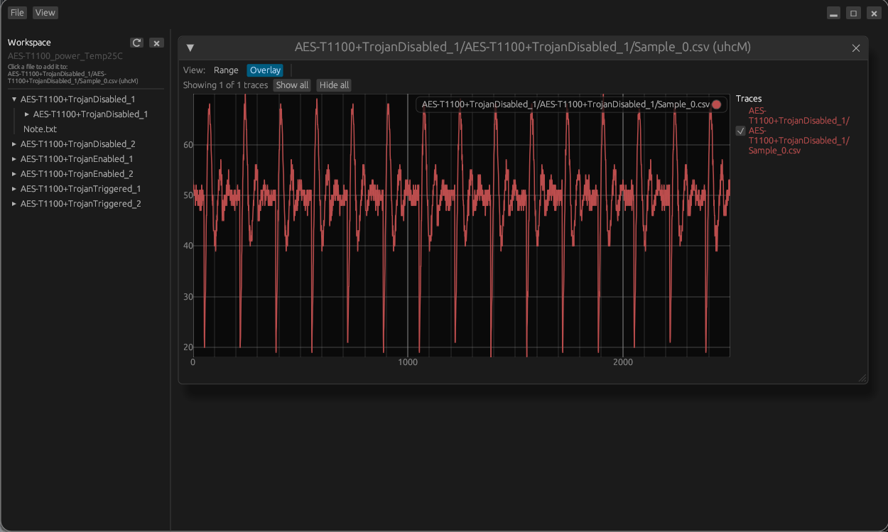

# SoftCore Side-Channel Analysis

A desktop tool, written in Rust, for viewing and comparing side-channel power traces.



## Running

Requires [Rust](https://rustup.rs).

```sh
cargo run --release
```

## Features

- **Workspaces** - open a folder of traces and browse it from the navigator.
- **Overlay traces** - stack traces from different files in one plot and toggle each on or off.
- **Multiple plotters** - compare sets of traces side by side in separate windows.
- **Zoom and pan** - zoom in on a selected region and slide through long traces.

## Supported files

| Format | Layout |
| --- | --- |
| `.csv` / `.txt` | One value per line (single trace), or a time column followed by trace columns |
| `.bin` | zstd-compressed, bincode-encoded set of traces |

CSV files can use comma, semicolon, tab or space separators. Header lines are skipped.

## Usage

1. **File > Open Workspace...** and pick a folder.
2. Click a file in the navigator to add it to the front plotter. Click it again to remove it.
3. Right-click a file or folder for more options, such as opening it in a new plotter.

Use **View > Side Bar** to show or hide the navigator.

## Plot controls

| Action | Control |
| --- | --- |
| Select a region | Left-drag |
| Zoom to selection | `Enter` |
| Undo zoom / clear selection | `Esc` |
| Slide the view | `Ctrl` + middle-drag |
| Step through traces (Range view) | Scroll wheel or `Up` / `Down` |
| Grow / shrink the range (Range view) | `Ctrl` + scroll wheel |

Each plotter has two views. **Overlay** shows the traces you tick in the list. **Range** shows a run of consecutive traces, which suits large `.bin` sets.
